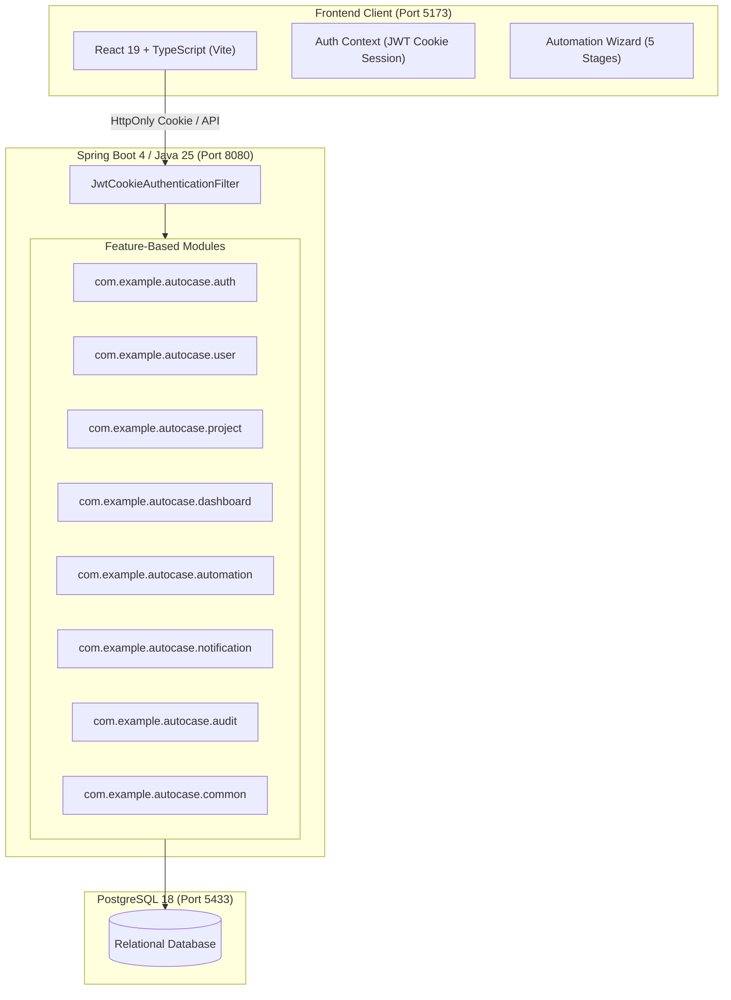

# Architecture & Package Structure

AutoCase AI is engineered as an enterprise-grade **modular monolith** with clear feature isolation.

---

## 1. High-Level System Architecture



---

## 2. Package-by-Feature Structure

The Java backend adheres to the **Package-by-Feature** paradigm. Each domain feature encapsulates its own Controller, Service, Repository, JPA Entities, and DTOs:

```
backend/src/main/java/com/example/autocase/
│
├── auth/                                    # Authentication & Security Feature
│   ├── AuthController.java                  # /api/auth/register, /login, /logout, /me
│   ├── AuthService.java                     # Cookie generation & authentication logic
│   ├── SecurityConfig.java                  # Spring Security filter chain configuration
│   ├── JwtCookieAuthenticationFilter.java   # OncePerRequestFilter for autocase_jwt cookie
│   ├── JwtTokenProvider.java                # HMAC-SHA JJWT token creation & parser
│   ├── CustomUserDetailsService.java        # Spring Security UserDetailsService
│   ├── UserPrincipal.java                   # UserDetails implementation
│   ├── LoginRequest.java                    # Login payload DTO
│   ├── RegisterRequest.java                 # Registration payload DTO
│   └── UserDto.java                         # User profile response DTO
│
├── user/                                    # User & RBAC Feature
│   ├── User.java                            # User entity with teams and roles
│   ├── Role.java                            # Role entity with permissions
│   ├── Permission.java                      # Granular permission entity
│   ├── UserRepository.java                  # JpaRepository for users
│   ├── RoleRepository.java                  # JpaRepository for roles
│   └── PermissionRepository.java            # JpaRepository for permissions
│
├── project/                                 # Project Feature
│   ├── Project.java                         # Automation project entity
│   └── ProjectRepository.java               # JpaRepository for projects
│
├── dashboard/                               # Dashboard Analytics Feature
│   ├── DashboardController.java             # /api/dashboard/stats
│   ├── DashboardStatsDto.java               # Quick stats aggregate DTO
│   ├── RecentProjectDto.java                # Recent projects list item DTO
│   └── RecentActivityDto.java               # Timeline item DTO
│
├── automation/                              # Automation Pipeline Feature
│   ├── AutomationController.java            # /api/generations/**
│   ├── AutomationService.java               # Workflow orchestrator & DB queries
│   ├── GenerationRequest.java               # Generation request entity
│   ├── GenerationRequestRepository.java     # JpaRepository for requests
│   ├── TestScenario.java                    # BDD scenario entity
│   ├── TestScenarioRepository.java          # JpaRepository for scenarios
│   ├── GeneratedArtifact.java               # Code file entity
│   ├── GeneratedArtifactRepository.java     # JpaRepository for code files
│   ├── ValidationRun.java                   # Compiler & syntax check entity
│   ├── ValidationRunRepository.java         # JpaRepository for validation runs
│   ├── GitDelivery.java                     # Git branch & MR delivery entity
│   └── GitDeliveryRepository.java           # JpaRepository for Git delivery
│
├── notification/                            # Notification Feature
│   ├── Notification.java                    # In-app notification entity
│   └── NotificationRepository.java          # JpaRepository for notifications
│
├── audit/                                   # Audit Governance Feature
│   ├── AuditEvent.java                      # Audit trail entity
│   └── AuditEventRepository.java            # JpaRepository for audit events
│
├── common/                                  # Common Cross-Cutting & Bootstrap
│   ├── ApiResponse.java                     # Standard JSON API envelope
│   └── DataInitializer.java                 # Seed runner for initial DB dataset
│
└── AutocaseApplication.java                 # Application entry point
```
