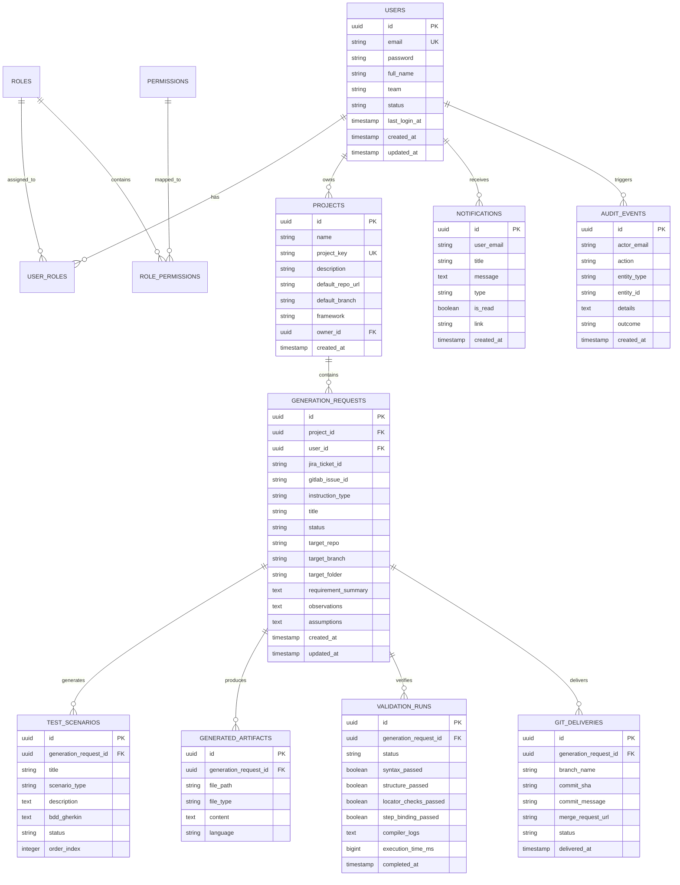

# Database Schema & Data Model

AutoCase AI uses **PostgreSQL 18** running in Docker on port `5433`. All entities are managed via **Spring Data JPA / Hibernate** with automatic DDL updates.

---

## 1. Entity-Relationship Diagram (ERD)

---

## 2. Table Descriptions

| Table Name | Entity Class | Purpose |
| :--- | :--- | :--- |
| `users` | `User.java` | User accounts, credentials, team affiliation, and account status |
| `roles` | `Role.java` | RBAC roles (`ROLE_ADMIN`, `ROLE_DEVELOPER_QA`, etc.) |
| `permissions` | `Permission.java` | Granular security privileges |
| `projects` | `Project.java` | Target automation repositories and framework configurations |
| `generation_requests` | `GenerationRequest.java` | Automation request lifecycle (Draft &rarr; Scenarios &rarr; Code &rarr; Delivered) |
| `test_scenarios` | `TestScenario.java` | Individual BDD/Gherkin test scenarios with human approval state |
| `generated_artifacts` | `GeneratedArtifact.java` | Feature files, Page Objects, and Step Definition code |
| `validation_runs` | `ValidationRun.java` | Compiler and locator validation outputs and logs |
| `git_deliveries` | `GitDelivery.java` | Git branch, commit SHA, and GitLab Merge Request metadata |
| `audit_events` | `AuditEvent.java` | Append-only governance and compliance audit trail |
| `notifications` | `Notification.java` | In-app user notifications and alerts |
