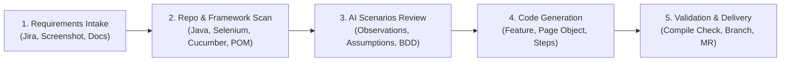

# End-to-End Automation Pipeline

The AutoCase AI generation pipeline automates test scenario design, framework adaptation, code synthesis, deterministic validation, and Git delivery.

---

## 1. Pipeline Stages

---

## 2. Detailed Stage Breakdown

### Stage 1: Multi-Source Requirements Intake
* **Inputs Supported**: Jira tickets, GitLab issues, manual text requirements, UI screenshots/mockups, screen recordings, existing test sheets, and Swagger/OpenAPI specs.
* **Separation of Concerns**: AI isolates observed facts (e.g. "Input field accepts 10 digits") from inferred assumptions (e.g. "Luhn check algorithm").

### Stage 2: Repository & Framework Detection
* **Scan Targets**: Analyzes `pom.xml`, `build.gradle`, directory structures, and existing Page Objects.
* **Detection Confidence**: Detects language (Java 21), build tool (Maven/Gradle), framework (Selenium + Cucumber BDD), and target directories (`src/test/java/...`).

### Stage 3: Scenario Generation & Human Approval
* **BDD Structure**: Generates readable Gherkin scenarios with Given-When-Then syntax.
* **Scenario Quality Categorization**: Positive/Happy Path, Validation/Boundary, Negative/Error State, and Component Behavior.
* **Human-in-the-Loop Gate**: Engineers review, edit, and approve scenarios before code generation begins.

### Stage 4: Framework-Compatible Code Generation
Produces production-grade artifacts conforming to existing conventions:
1. **Cucumber Feature File** (`src/test/resources/features/provider_search.feature`)
2. **Selenium Page Object** (`src/main/java/com/healthtech/pages/ProviderSearchPage.java`)
3. **Step Definitions** (`src/test/java/com/healthtech/steps/ProviderSearchSteps.java`)

### Stage 5: Deterministic Validation & Safe Git Delivery
* **Pre-Delivery Validation**: Executes syntax verification, Page Object locator structure check, and step-to-method binding verification.
* **Isolated Branch Delivery**:
  * AI creates a feature branch: `ai-generated/JIRA-1234-provider-search-tests`
  * Commits validated automation files without touching `main`
  * Opens a GitLab Merge Request (`MR #42`) for review.
* **Governance**: Records an immutable audit log entry in `audit_events` and posts an in-app notification to the user.
